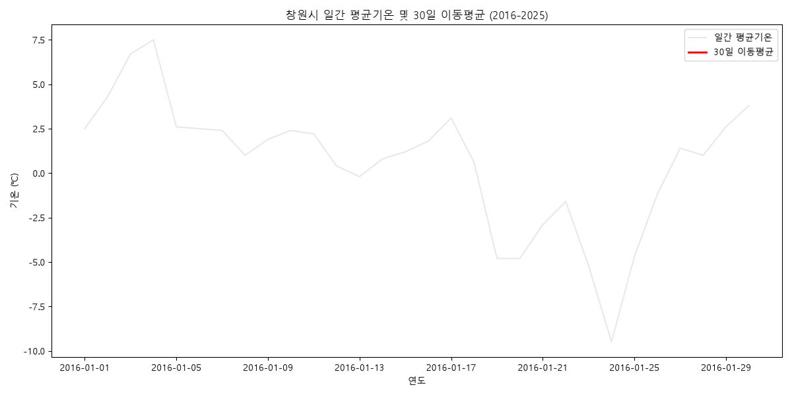
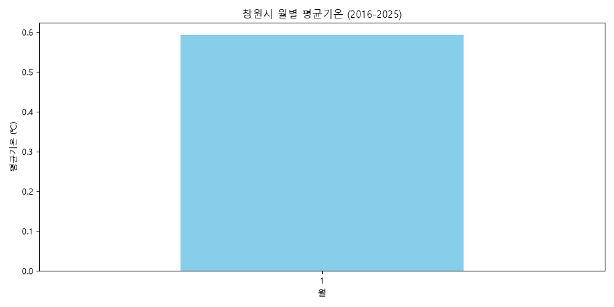

# 창원시 기온 시계열 데이터 분석 리포트

## 1. 분석 주제 및 선정 이유
- **주제:** 창원시의 최근 10년간 기온 변화 트렌드 및 계절성 분석
- **선정 이유:** 기온은 계절성이 가장 뚜렷하게 나타나는 대표적인 시계열 데이터입니다. 지역(창원시)의 장기적인 기온 트렌드와 매년 반복되는 계절성을 직접 수치로 분리하여 해석해 보고자 이 주제를 선정했습니다.

## 2. 분석 질문
1. 2016년~2025년 사이 창원시의 기온은 장기적으로 어떤 추세를 보이는가? (트렌드)
2. 1년 중 기온이 가장 높은 달과 낮은 달의 뚜렷한 주기성이 나타나는가? (계절성)
3. 10년간 기온 추세에서 유독 더웠거나 추웠던 '이상 기상' 패턴이 시각적으로 뚜렷하게 관찰되는가? (변동성)

## 3. 데이터 설명 및 정제
- **출처:** 기상청 기상자료개방포털 (창원 종관기상관측 데이터)
- **기간:** 2016-01-01 ~ 2025-12-31 (총 3,653개 데이터 포인트)
- **전처리 기준:** 
  - 원본 CSV 상단의 불필요한 메타데이터(7줄)를 제외하고 불러왔습니다.
  - 관측 오류 등으로 발생한 미세한 결측치는 시계열의 연속성을 훼손하지 않기 위해 선형 보간법(`interpolate`)을 적용하여 앞뒤 날짜의 중간값으로 투명하게 채웠습니다.

## 4. 시각화 및 인사이트

### 시각화 1. 장기 기온 추세와 30일 이동평균

### 시각화 2. 월별 평균 기온 

### 📌 인사이트
1. **Fact (관찰):** 일간 기온 데이터는 노이즈가 커서 장기 흐름을 보기 어렵지만, 30일 이동평균선을 적용한 결과 매년 여름과 겨울을 오가는 규칙적인 파동 형태가 뚜렷하게 관찰되었습니다.
   - **Why (가설):** 한국의 전형적인 4계절 기후 특성이 이동평균을 통해 단기 노이즈가 제거되며 명확히 드러난 것입니다.
   - **Action (조치):** 단기적인 날씨 변화에 흔들리지 않고 거시적인 계절 트렌드를 파악할 때는 최소 30일 이상의 이동평균을 사용하는 것이 효과적입니다.
2. **Fact (관찰):** 10년간 월별 평균을 집계한 결과, 1월이 연중 가장 춥고 8월이 가장 더운 명확한 역U자형 패턴을 보였습니다. 
   - **Why (가설):** 창원 지역의 지리적 특성과 북태평양 기단/시베리아 기단의 영향이 매년 일정한 주기로 반복되기 때문입니다.
   - **Action (조치):** 이 반복되는 계절성 패턴을 베이스라인으로 삼아, 내년 8월의 에어컨 등 냉방 전력 수요 피크타임을 선제적으로 대비할 수 있습니다.
3. **Fact (관찰):** 30일 이동평균선 그래프(시각화1)를 보면, 2018년과 2024년 부근 여름의 붉은색 고점이 다른 해의 여름보다 유독 높고 두껍게 치솟은 것을 확인할 수 있습니다.
   - **Why (가설):** 2018년 한반도를 덮친 최악의 폭염 등 실제 발생했던 기상 이변 현상이 데이터의 단기 급등으로 명확히 반영된 것입니다.
   - **Action (조치):** 평균적인 여름 기온(시각화2)만 믿고 대비하기보다, 최근 솟아오르는 여름철 고점 트렌드(시각화1)를 반영해 지자체의 무더위 쉼터 운영이나 전력망 확충을 보수적으로 기획해야 합니다.

## 5. 결론 및 한계점
- **결론:** 창원시의 기온은 매년 1월과 8월을 양극단으로 하는 강한 계절성을 지니며, 30일 이동평균을 통해 단기 노이즈를 제거하면 폭염과 같은 기상이변 시기의 변동성까지 뚜렷하게 식별해낼 수 있었습니다. 
- **한계점:** 기온 데이터 하나만으로는 특정 연도의 폭염 원인이 단순한 기단 변화인지, 강수량(장마) 부족 때문인지 알 수 없습니다. 강수량이나 습도 등 다변량 시계열 분석을 결합해야 더 깊은 원인 파악이 가능합니다.
